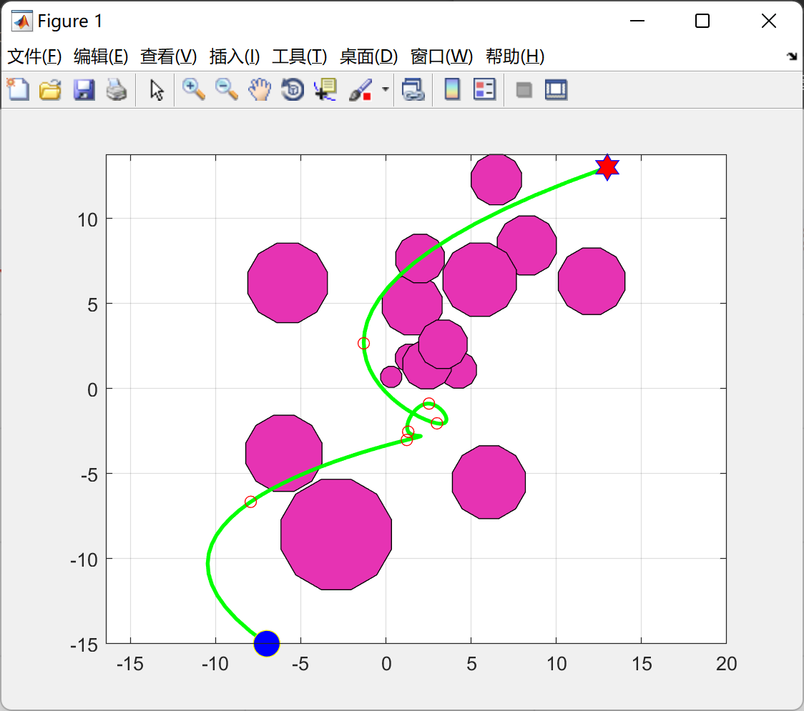
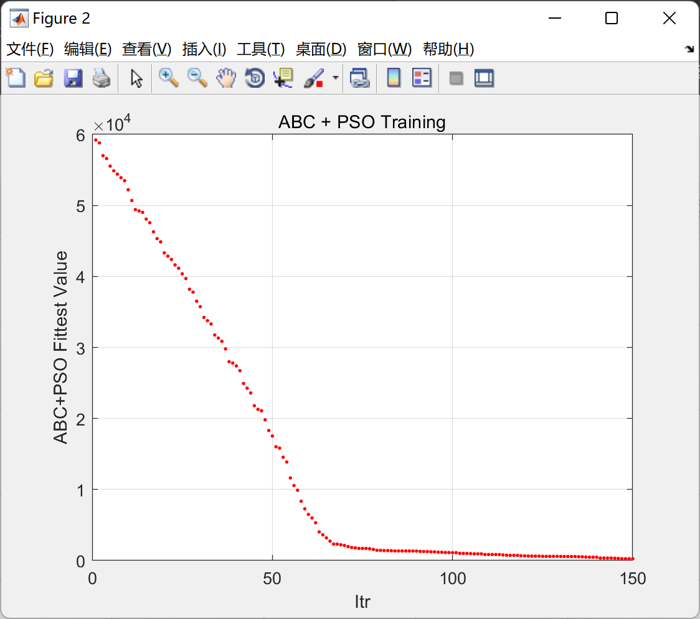

# Optimal Robot Path Planning Based on Particle Swarm Optimization Algorithm (Matlab Code Implementation)

1. Overview
In recent years, intelligent robots have gradually been applied in numerous fields such as healthcare, services, and aviation. Path planning, as a key technology for robots to achieve intelligent autonomous planning, has attracted widespread attention from many scholars. Its specific meaning refers to the real-time path planning algorithm for mobile robots in environments with obstacles, which is relatively slow in real-time performance and complex in implementation, making it difficult to ensure high precision of search results under existing technological conditions. In static path planning algorithms, it refers to the self-planned effective path for mobile robots in real-space environments with obstacles. Path planning can be divided into static and dynamic path planning based on the degree of effective information available from the external environment. The A* algorithm, compared to human potential field method, LPA* algorithm, Dijkstra algorithm, Genetic algorithm, etc., is introduced into static path planning due to its advantages of fast efficiency, high flexibility, and accurate precision. However, traditional A* algorithm-planned paths still have issues such as excessively cluttered points and turning points, and poor search efficiency. Moreover, some paths are not smooth enough with sharp corners.
Particle Swarm Optimization Algorithm (with Constraint Handling) - Python & Matlab Implementation
2. Run Results
\n\n3. Matlab Code Implementation: This section only showcases part of the code, all codes can be found in:
Optimal Robot Path Planning Based on Particle Swarm Optimization Algorithm (Matlab Code Implementation)
function model=CreateModel()\n\n    % Source\n    xs=0;\n    ys=0;\n    \n    % Target (Destination)\n    xt=4;\n    yt=6;\n    \n    xobs=[1.5 4.0 1.2];\n    yobs=[4.5 3.0 1.5];\n    robs=[1.5 1.0 0.8];\n    \n    n=3;\n    \n    xmin=-10;\n    xmax= 10;\n    \n    ymin=-10;\n    ymax= 10;\n    \n    model.xs=xs;\n    model.ys=ys;\n    model.xt=xt;\n    model.yt=yt;\n    model.xobs=xobs;\n    model.yobs=yobs;\n    model.robs=robs;\n    model.n=n;\n    model.xmin=xmin;\n    model.xmax=xmax;\n    model.ymin=ymin;\n    model.ymax=ymax;\n    \nend\n  
​  

## Images

<!-- PAYMENT_BLOCK -->

## Get this dataset

- Payment link (Stripe): [Buy now](https://buy.stripe.com/3cs8yP7sY87d0vu9AB)
- Payment QR code: 

<!-- /PAYMENT_BLOCK -->
